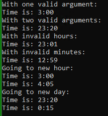

# Chapter 10 – Lab 1 
Programming Example – Juice Machine (Pages 707-721) 
## Instructions: 
This lab is made up of one assignment from the Programming Examples in the book.   
## Grading:  
2 – General, compiles, comments, proper indentation, etc  
8 – JuiceMachine.cpp  
 
Total: 10 
##  
# Chapter 10 – Lab 2 
## Instructions: 
Create a class named Time that has integer fields for hours and minutes. Store the hours in military time (0-23). Create the following functions: 
- display() - Displays fields, using a colon to separate hours and minutes (minutes should display as 2 digits – 4:00 not 4:0) 
- add(int m) - Takes an argument that represents minutes to add to the time. This function updates the time based on the number of minutes, making sure to “roll over” for hours. 
- Examples: 
	- 12:30 plus 15 is 12:45 
	- 14:50 plus 20 is 15:10 
	- 23:59 plus 2 is 0:01 

The Time constructor requires an argument for hours and minutes. If no argument for minutes is supplied, the default is 0. It also makes sure the hours field is not more than 23 and the minutes field is not more than 59. For example, 25:61 would not be allowed. Any hours over 23 would default to 23, and any minutes over 59 would default to 59. 

## Use this provided main() method to test your class:
```cpp
int main() 
{
	Time t1(3);
	cout << "With one valid argument:\n";
	t1.display();
	Time t2(23, 20);
	cout << "With two valid arguments:\n";
	t2.display();
	Time t3(24, 1);
	cout << "With invalid hours:\n";
	t3.display();
	Time t4(12, 62);
	cout << "With invalid minutes:\n";
	t4.display();
	cout << "Going to new hour:\n";
	t1.display();
	t1.add(65);
	t1.display();
	cout << "Going to new day:\n";
	t2.display();
	t2.add(55);
	t2.display();
	return 0;
}
```
## Grading:  
2 – General, compiles, comments, proper indentation, etc  
2 – Class variables  
4 – Constructors  
4 – display function  
4 – add function  
  
Total: 16  
  
## Example: 

